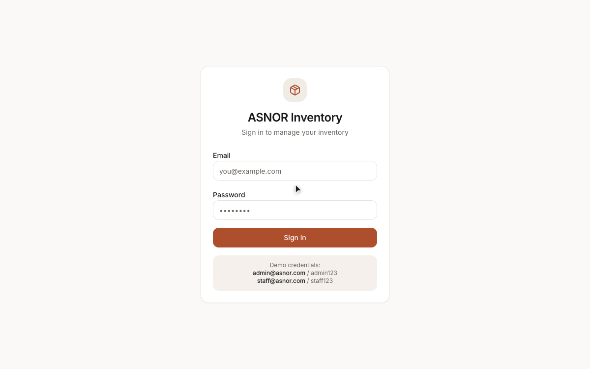
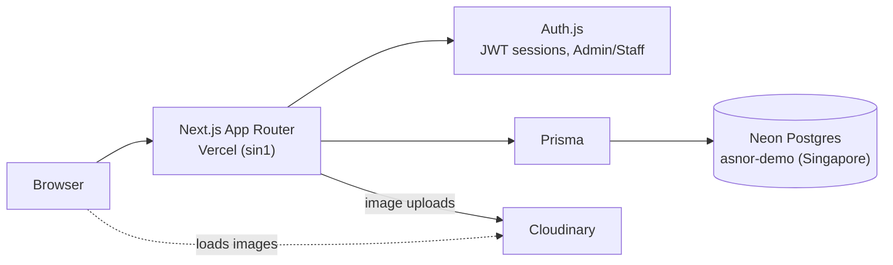

# ASNOR Inventory Management System

[](https://github.com/Hadjiiiiii/asnor-inventory/actions/workflows/ci.yml)

Inventory and sales tracking for a phone and electronics resale shop: every device by serial/IMEI, every buy and sell, profit per sale.

**Live demo:** https://asnor-inventory.vercel.app (sign in with the [demo login](#demo-login))



**What's interesting here:** the public demo runs on its own database with fake seed data, split from real shop data; Admin and Staff roles gate routes and actions; devices are tracked one by one by serial/IMEI while accessories are tracked by quantity.

## Architecture



## Features

- **Inventory Management** — Individual device tracking (serial/IMEI) and quantity-based accessory stock
- **Buy/Sell Transactions** — Record purchases and sales with automatic profit calculation
- **Condition Grading** — Track device condition: New, Like New, Good, Fair, Parts
- **Supplier & Customer Management** — Contact directory linked to transaction history
- **Image Uploads** — Multiple photos per product via Cloudinary (25GB free tier)
- **Dashboard & Reports** — Real-time metrics, monthly trends chart, low-stock alerts
- **Role-Based Access** — Admin and Staff roles with protected routes
- **Responsive Design** — Works on desktop and tablet (Claude-inspired UI)

## Tech Stack

- **Framework:** Next.js 16 (App Router)
- **Database:** PostgreSQL with Prisma 7 ORM
- **Auth:** Auth.js v5 (next-auth@beta) with JWT sessions
- **Images:** Cloudinary (free tier)
- **UI:** Tailwind CSS v4 + custom components (shadcn/ui-inspired)
- **Charts:** Recharts
- **Deployment:** Vercel

## Getting Started

### Prerequisites

- Node.js 20.9+ (CI uses 22)
- PostgreSQL database (local or cloud — [Neon](https://neon.tech) has a free tier)
- Cloudinary account (free: [cloudinary.com](https://cloudinary.com))

### Setup

1. **Clone and install dependencies:**
   ```bash
   cd ASNOR
   npm ci
   ```

2. **Configure environment variables:**
   ```bash
   cp .env.example .env
   ```
   Fill in `.env` (names only here, never commit values):
   - `DATABASE_URL`: PostgreSQL connection string for your own data
   - `AUTH_SECRET`: generate with `openssl rand -base64 32`
   - `AUTH_URL`: `http://localhost:3000` for local dev
   - `NEXT_PUBLIC_CLOUDINARY_CLOUD_NAME`, `CLOUDINARY_API_KEY`, `CLOUDINARY_API_SECRET`: from the Cloudinary dashboard
   - `SHOP_TIMEZONE`: IANA zone the dashboard's "today" follows

3. **Set up the demo database** (a separate Postgres database with fake data):
   ```bash
   # .env.demo.local holds DEMO_DATABASE_URL, which must differ from DATABASE_URL
   npm run db:generate   # Generate Prisma client
   npm run demo:push     # Push the schema to the demo database
   npm run demo:seed     # Wipe the demo database and fill it with fake data
   ```
   `demo:seed` refuses to run if `DEMO_DATABASE_URL` is missing or points at the same database as `DATABASE_URL`.

4. **Run the development server:**
   ```bash
   npm run dev
   ```
   Open [http://localhost:3000](http://localhost:3000)

### Demo login

| Role  | Email             | Password |
|-------|-------------------|----------|
| Admin | admin@asnor.com   | admin123 |
| Staff | staff@asnor.com   | staff123 |

The live demo hands out an Admin login, so visitors can edit or delete demo data. The data is fake and nothing resets it automatically: re-run `npm run demo:seed` after showing the demo to someone.

## Project Structure

```
src/
├── app/
│   ├── (app)/              # Authenticated app routes
│   │   ├── dashboard/      # Dashboard with metrics & charts
│   │   ├── inventory/      # Product CRUD & management
│   │   ├── transactions/   # Buy/sell transaction tracking
│   │   ├── contacts/       # Supplier & customer management
│   │   └── users/          # Admin user management
│   ├── api/                # API routes (auth, images, data)
│   └── login/              # Login page
├── components/
│   ├── ui/                 # Reusable UI components
│   ├── sidebar.tsx         # Navigation sidebar
│   ├── providers.tsx       # Session & toast providers
│   └── image-upload.tsx    # Cloudinary upload component
├── lib/
│   ├── auth.ts             # Auth.js configuration
│   ├── prisma.ts           # Database client
│   └── utils.ts            # Utility functions
└── generated/prisma/       # Generated Prisma client (gitignored)
```

## Available Scripts

| Command | Description |
|---------|-------------|
| `npm run dev` | Start development server |
| `npm run build` | Build for production |
| `npm run start` | Start production server |
| `npm run db:push` | Push schema changes to database |
| `npm run db:seed` | Seed database with sample data |
| `npm run demo:push` | Push schema to the demo database (`DEMO_DATABASE_URL`) |
| `npm run demo:seed` | Reset the demo database with fake data |
| `npm run db:studio` | Open Prisma Studio (database GUI) |
| `npm run db:migrate` | Create and apply migrations |
| `npm run db:generate` | Regenerate Prisma client |

## Deployment (Vercel)

1. Push your code to GitHub
2. Connect the repository on [Vercel](https://vercel.com)
3. Add environment variables in Vercel project settings
4. Deploy — Vercel will automatically build and deploy

**Build command** is already configured: `npx prisma generate && next build`

## Design System

The UI is inspired by Claude's design language:
- **Font:** Inter
- **Colors:** Warm whites/cream (#FAF9F7), subtle borders (#e8e2db), terracotta accent (#ad4f2d, deepened from #c96442 to meet AA contrast), control borders (#8f8780)
- **Components:** Rounded corners (0.75rem), generous spacing, soft shadows
- **Feel:** Calm, professional, highly readable
